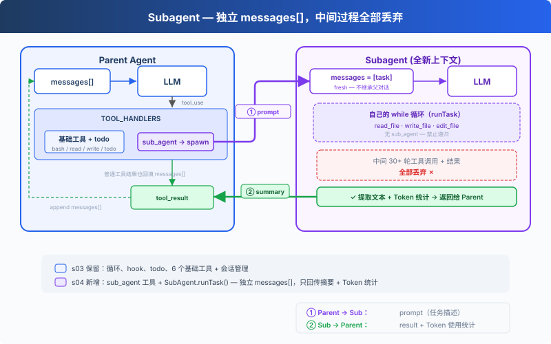

# hoppinzq-module-agent-04-subagent（子智能体）

> 说明：下方"历史实现"章节保留了重构前的代码片段（`AnthropicClient`、两参 `setSessionManager`、
> `ToolDefinition` 静态技能字段等），仅作演进对照；当前 API 以本页末尾「能力化架构」与源码为准。


> *"大任务拆小，每个小任务干净的上下文"* -- 子智能体使用独立上下文，不污染主对话

## 项目简介

Agent04 在 Agent03（TodoManager + nag reminder）的基础上，新增了**子智能体（SubAgent）**功能。通过将大任务拆分为多个子任务，每个子任务在独立的上下文中执行，只返回摘要给父智能体，从而保持主对话的清洁和高效。

### 核心特性

- **上下文隔离**：子智能体使用独立的 messages[] 数组，不污染父智能体的上下文
- **工具过滤**：子智能体只有 3 个文件工具（read/edit/write），不能递归创建子智能体
- **摘要返回**：子智能体只返回最终的文本摘要，丢弃所有中间工具调用历史
- **静态工具类**：`SubAgent` 是静态工具类（非实例方法），通过 `SubAgent.executeSubAgent()` 调用
- **TodoManager 继承**：保留 agent-03 的待办事项管理和 nag reminder 机制
- **类型安全**：使用 Java 泛型实现类型安全的工具调用

## 实现原理

### 架构设计



### 核心组件

#### 1. Agent04（主智能体）

继承自 ZQAgent，在 Agent03 的基础上新增 `sub_agent` 工具:

```java
public class Agent04 extends ZQAgent {
    public static TodoManager todoManager;
    private int roundsSinceTodo = 0;
    private long lastTodoVersion = 0;

    public static void main(String[] args) {
        List<ToolDefinition> tools = new ArrayList<>();
        tools.add(BashDefinition);
        tools.add(ReadFileDefinition);
        tools.add(EditFileDefinition);
        tools.add(WriteFileDefinition);
        tools.add(GlobDefinition);
        tools.add(ContentSearchDefinition);
        tools.add(TodoDefinition);
        tools.add(SubAgentDefinition);

        Agent04 mainAgent = new Agent04(client, MODEL, tools, todoManager);
        mainAgent.setSystemPrompt(buildSystemPrompt());
        mainAgent.run();
    }
}
```

#### 2. SubAgent（子智能体静态工具类）

`SubAgent` 位于 `com.hoppinzq.agent.base` 包下，是一个**静态工具类**（不是实例方法）:

```java
public class SubAgent {
    public static String executeSubAgent(LlmProvider provider,
                                         String model, SubAgentInput input) {
        List<ToolDefinition> subTools = new ArrayList<>();
        subTools.add(ReadFileDefinition);
        subTools.add(EditFileDefinition);
        subTools.add(WriteFileDefinition);

        ZQAgent subAgent = new ZQAgent(provider, model, subTools);
        subAgent.setSystemPrompt(
            "你是一个子智能体。你已接收一个具体任务，"
            + "请使用可用的工具来完成该任务。任务完成后，请直接返回结果。");

        String result = subAgent.runTask(input.getPrompt());
        return result;
    }
}
```

**关键设计决策**:
- 子智能体只有 3 个文件工具 -- **没有 bash**（更安全），**没有 sub_agent**（防止递归）
- 子智能体从空的 messages[] 开始，运行自己的 `runTask()` 循环
- 只返回最终文本结果，丢弃所有中间上下文

#### 3. SubAgentDefinition（工具定义）

```java
public static ToolDefinition SubAgentDefinition = new ToolDefinition(
    "sub_agent",
    "将子任务委托给子智能体处理。子智能体拥有读取文件、写入文件、编辑文件"
    + "和搜索内容等工具能力，专门用于处理具体的文件操作任务。",
    createInputSchema(
        Map.of("prompt", createProperty("string",
            "给子智能体的任务提示词，详细描述需要完成的任务")),
        List.of("prompt")
    ),
    SubAgentInput.class,
    Tools::executeSubAgent
);
```

#### 4. 父子工具对比

| 工具 | 父智能体 (Agent04) | 子智能体 (SubAgent) |
|-----|-------------------|-------------------|
| bash | 有 | **无** |
| read_file | 有 | 有 |
| write_file | 有 | 有 |
| edit_file | 有 | 有 |
| glob | 有 | **无** |
| content_search | 有 | **无** |
| todo | 有 | **无** |
| sub_agent | 有 | **无** |

子智能体被刻意精简为 3 个工具，遵循最小权限原则。

## 使用方法

### 环境要求

- Java 17+
- Maven 3.6+
- Anthropic API Key 或兼容的 API 服务

### 编译运行

```bash
cd hoppinzq-module-agent-04
mvn clean compile
mvn exec:java -Dexec.mainClass="com.hoppinzq.agent.Agent04"
```

### 交互示例

```
你: 使用子智能体查找这个项目使用的测试框架
AI: 我会使用子智能体来搜索项目中的测试框架配置。
工具: sub_agent(prompt="Search for testing framework configurations...")
结果: This project uses JUnit 5 for testing. Found pom.xml with junit-jupiter dependency.
AI: 根据子智能体的报告，这个项目使用 JUnit 5 作为测试框架。
```

### 推荐测试用例

1. `使用子智能体查找这个项目使用的测试框架`
2. `派发子任务：读取所有 .java 文件并总结各自的功能`
3. `用子智能体创建一个新模块，然后从这里验证它`
4. `用子任务读取所有 .md 文件并总结项目结构`
5. `使用子智能体搜索代码中的 "TODO" 注释并汇总`

## 项目结构

```
hoppinzq-module-agent-04/
├── src/main/java/com/hoppinzq/agent/
│   ├── Agent04.java                    # 主智能体类（父智能体）
│   ├── base/
│   │   ├── ZQAgent.java                # 基础智能体
│   │   └── SubAgent.java               # 子智能体静态工具类
│   ├── tool/
│   │   ├── ToolDefinition.java         # 工具定义（含 SubAgentDefinition）
│   │   ├── Tools.java                  # 工具实现
│   │   ├── schema/
│   │   │   ├── BashInput.java
│   │   │   ├── ReadFileInput.java
│   │   │   ├── WriteFileInput.java
│   │   │   ├── EditFileInput.java
│   │   │   ├── GlobInput.java
│   │   │   ├── ContentSearchInput.java
│   │   │   └── SubAgentInput.java
│   │   └── manager/
│   │       └── TodoManager.java        # 待办事项管理器
│   └── constant/
│       └── AIConstants.java            # 常量配置
├── pom.xml
├── README.md
└── s4.md
```

## 技术栈

| 技术 | 说明 |
|-----|------|
| Java 17 | 编程语言 |
| Maven | 构建工具 |
| Anthropic Java SDK | AI SDK |
| OkHttp | HTTP 客户端 |
| Jackson | JSON 处理 |
| Lombok | 代码简化 |

## 设计亮点

1. **上下文隔离**：子智能体使用独立 messages[]，避免污染父对话历史
2. **最小权限**：子智能体仅 3 个文件工具，无 bash/sub_agent/todo
3. **防递归**：子智能体没有 sub_agent 工具，从根本上防止无限递归
4. **静态工具类**：SubAgent 作为静态类设计，无需实例化即可调用
5. **共享 TodoManager**：父智能体的待办事项管理在子任务执行期间持续追踪

## 扩展开发

### 添加新工具到子智能体

在 `SubAgent.executeSubAgent()` 中修改 `subTools` 列表:

```java
List<ToolDefinition> subTools = new ArrayList<>();
subTools.add(ReadFileDefinition);
subTools.add(EditFileDefinition);
subTools.add(WriteFileDefinition);
subTools.add(YourNewDefinition);  // 新增工具
```

### 自定义子智能体行为

修改 `SubAgent.executeSubAgent()` 中的系统提示词或创建自定义版本。

---

## 能力化架构（2026-10 重构）

本工程的内核与特性已彻底分离：**内核不感知任何具体能力**，特性以能力包形式插拔。

### 内核（25 个模块逐字节一致）

| 目录 | 职责 |
|---|---|
| `client/` | 协议中立模型 + 全能 Provider（OpenAI / Anthropic，均支持 stream、扩展思考 think、多模态） |
| `session/` | 会话持久化（`.sessions/*.json`）、消息转换、token 统计、thinking 签名回填 |
| `base/ZQAgent` | 主循环 + 能力注册（`agent.capability(...)`）+ 四类钩子分发 + 命令收集 |
| `command/AgentCommandHandler` | 内置命令（`/stats` `/usage` `/exit`）+ 能力注册的斜杠命令 |
| `capability/{Capability,AgentHook,AgentCommand}` | 能力契约（工具 / 钩子 / 命令 / 提示片段 / 生命周期） |

内核一致性由 `bin/check-kernel-sync.sh` 校验（以 06-compact 为权威源）。

### 本模块的能力包

| 目录 | 职责 |
|---|---|
| `capability/todo/` | 待办清单（todo 工具） |
| `capability/subagent/` | 子智能体（sub_agent：独立上下文 + token 用量回传） |
入口类只负责装配：复制能力目录 + 一行注册。

```java
XxxCapability cap = new XxxCapability(...);
agent.capability(cap);
agent.setSystemPrompt(basePrompt + "

" + String.join("
", cap.promptFragments()));
```

### 快速开始

```bash
# 1) 编译（工程根目录）
mvn -pl hoppinzq-module-agent-04-subagent compile

# 2) 运行入口类（IDE 里直接运行，或在根目录）
mvn -pl hoppinzq-module-agent-04-subagent exec:java -Dexec.mainClass=com.hoppinzq.agent.Agent04
```

环境变量：`DEEPSEEK_API_KEY`（必填)；协议与模型在 `constant/AIConstants` 中配置
（`PROVIDER=openai|anthropic`、`OPENAI_BASE_URL`、`ANTHROPIC_BASE_URL`、`MODEL`、`THINK_ENABLED`）。

### 最近变更（与本模块相关）

- **能力化重构**：特性从入口类覆写 / 静态字段迁入 `capability/<feature>/`，入口类只做装配
- **内核解耦**：`/skills` 与 `SkillLoader`、`SubAgentSessionResult` 与子智能体运行逻辑已移出内核；
  内核 `setSessionManager` 为单参、`AgentCommandHandler` 不再持有技能类型
- **协议层全能版**：流式 `stream()`、扩展思考 think（含 Anthropic thinking 块签名回传）、多模态内容块
- **bash 工具加固**：120s 超时强杀、stderr 合并读取（防管道死锁）、危险命令黑名单、
  5 万字符截断、读写统一 UTF-8、glob 结果 200 条上限
- **上下文压缩修复**：snip 触发/目标分离（迟滞）、本轮工具结果整批保留、压缩后保留当前用户请求
