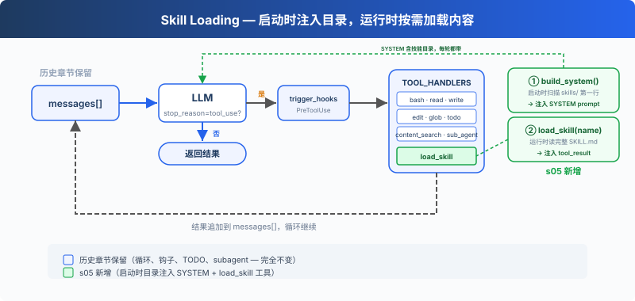

# hoppinzq-module-agent-05-skill（技能加载）

> 说明：下方"历史实现"章节保留了重构前的代码片段（`AnthropicClient`、两参 `setSessionManager`、
> `ToolDefinition` 静态技能字段等），仅作演进对照；当前 API 以本页末尾「能力化架构」与源码为准。


## 项目简介

Agent05 在 Agent04 的基础上引入了**技能加载（Skill Loading）**机制。通过两层注入架构，避免在系统提示中塞入所有知识内容，实现按需加载专业领域知识。

## 核心特性

- **两层技能注入**：Layer 1（系统提示放名称+描述，~100 tokens/skill）→ Layer 2（tool_result 按需注入完整内容，~2000 tokens）
- **YAML Frontmatter**：技能文件支持标准 YAML 元数据定义（name、description）
- **递归扫描**：自动扫描 `skills/` 目录下所有 `SKILL.md` 文件，支持文件系统和 JAR 两种加载方式
- **待办事项管理**：继承 Agent04 的 TodoManager，3 回合未更新自动催办
- **子智能体委托**：继承 Agent04 的 SubAgent 静态工具类
- **9 个工具**：bash、read_file、write_file、edit_file、glob、content_search、sub_agent、todo、load_skill

## 实现原理

### 两层注入架构



### Agent05 类结构

```java
public class Agent05 extends ZQAgent {
    public static TodoManager todoManager;
    public static SkillLoader skillLoader;
    private int roundsSinceTodo = 0;
    private long lastTodoVersion = 0;

    public Agent05(LlmProvider provider, String model,
                   List<ToolDefinition> tools,
                   SkillLoader skillLoader,
                   TodoManager todoManager) {
        super(client, model, tools);
        Agent05.skillLoader = skillLoader;
        Agent05.todoManager = todoManager;
        this.lastTodoVersion = todoManager.getVersion();
    }
}
```

**设计要点**：
- `skillLoader` 和 `todoManager` 使用**静态字段**桥接给 ToolDefinition 中的工具引用
- 构造函数注入，但通过静态字段传递，因为 `ToolDefinition` 中的静态工具定义需要引用它们

### SkillLoader 核心实现

```java
public class SkillLoader {
    private final Map<String, String> skills = new HashMap<>();

    public SkillLoader() {
        loadSkills();  // 递归扫描所有 SKILL.md
    }

    // Layer 1: 名称+描述列表（注入系统提示）
    public String getDescriptions() { ... }

    // Layer 2: 完整技能内容（注入 tool_result）
    public String getSkill(String skillName) { ... }

    // 解析 YAML frontmatter: ---\n name: xxx\n description: xxx\n ---
    private void parseSkillContent(String entryName, String content) {
        Pattern pattern = Pattern.compile("^---\\n(.*?)\\n---\\n(.*)", Pattern.DOTALL);
        Matcher matcher = pattern.matcher(content);
        if (matcher.find()) {
            String meta = matcher.group(1);
            String body = matcher.group(2).trim();
            // 解析 name 和 description
            skills.put(name, String.format(
                "<skill name=\"%s\" description=\"%s\">\n%s\n</skill>",
                name, description, body));
        }
    }
}
```

### load_skill 工具定义

```java
public static ToolDefinition SkillsDefinition = new ToolDefinition(
    "load_skill",
    "加载指定的技能（工具集合）。可用技能："
        + String.join(", ", Agent05.skillLoader.getAvailableSkills()),
    createInputSchema(
        Map.of("skill_name", createProperty("string", "要加载的技能名称")),
        List.of("skill_name")
    ),
    LoadSkillInput.class,
    Tools::skillLoad
);
```

### onToolExecution 钩子

继承自 Agent04 的催办机制，在每次工具执行后检查 TodoManager 版本变化：

```java
@Override
protected void onToolExecution(List<ContentBlockParam> toolResults) {
    long currentVersion = todoManager.getVersion();
    if (currentVersion > lastTodoVersion) {
        roundsSinceTodo = 0;
        lastTodoVersion = currentVersion;
    } else {
        roundsSinceTodo++;
    }
    if (roundsSinceTodo >= 3) {
        // 注入催办提醒到 toolResults
    }
}
```

## 使用方法

### 配置

在 `AIConstants.java` 中配置 API 和技能路径：

```java
public static final String BASE_URL = "https://hoppinzq.com:520/deepseek/anthropic";
public static final String API_KEY = "your-api-key";
public static final String MODEL = "deepseek-v4-flash";
public static final String SKILL_PATH = "skills";
```

### 添加新技能

在 `src/main/resources/skills/` 下创建目录和 `SKILL.md`：

```markdown
---
name: my-skill
description: 我的自定义技能
---

# 技能内容
...
```

### 编译运行

```bash
cd hoppinzq-module-agent-05
mvn clean compile
mvn exec:java -Dexec.mainClass="com.hoppinzq.agent.Agent05"
```

## 项目结构

```
hoppinzq-module-agent-05/
├── src/main/java/com/hoppinzq/agent/
│   ├── Agent05.java                 # 主智能体（extends ZQAgent）
│   ├── base/
│   │   ├── ZQAgent.java             # 基础智能体
│   │   └── SubAgent.java            # 子智能体静态工具类
│   ├── tool/
│   │   ├── ToolDefinition.java      # 9 个工具定义
│   │   ├── Tools.java               # 工具实现
│   │   ├── manager/
│   │   │   └── TodoManager.java     # 待办事项管理器
│   │   ├── skill/
│   │   │   └── SkillLoader.java     # 技能加载器（★ 新增）
│   │   └── schema/
│   │       ├── LoadSkillInput.java  # load_skill 输入 Schema
│   │       └── ...                  # 其他工具 Schema
│   └── constant/
│       └── AIConstants.java         # API 配置
├── src/main/resources/
│   └── skills/                      # 技能文件目录
│       ├── code-review/SKILL.md
│       ├── git/SKILL.md
│       └── test/SKILL.md
└── s5.md                            # 教程文档
```

## 技术栈

| 技术 | 用途 |
|-----|------|
| Java 17+ | 开发语言 |
| Anthropic Java SDK | LLM API 调用 |
| Maven | 项目构建 |
| YAML Frontmatter | 技能元数据格式 |
| Jackson ObjectMapper | JSON 序列化 |

## 设计亮点

1. **两层注入节省 Token**：10 个技能全部塞系统提示需 20,000 tokens，两层注入每次请求仅需 ~1,000 tokens
2. **静态字段桥接**：ToolDefinition 的静态工具定义通过 `Agent05.skillLoader` 和 `Agent05.todoManager` 访问实例依赖
3. **双模式加载**：SkillLoader 支持文件系统（开发时）和 JAR（打包后）两种技能加载方式
4. **XML 包装格式**：技能内容用 `<skill name="" description="">...</skill>` XML 标签包装，便于 LLM 解析

## 扩展开发

### 添加新技能

1. 在 `src/main/resources/skills/` 下创建子目录
2. 编写 `SKILL.md`，包含 YAML frontmatter 和技能内容
3. 重启智能体，技能自动加载

### 添加新工具

在 `ToolDefinition.java` 中添加新的静态字段，参考现有工具定义格式，然后在 `main()` 中注册。

---

## 能力化架构（2026-10 重构）

本工程的内核与特性已彻底分离：**内核不感知任何具体能力**，特性以能力包形式插拔。

### 内核（25 个模块逐字节一致）

| 目录 | 职责 |
|---|---|
| `client/` | 协议中立模型 + 全能 Provider（OpenAI / Anthropic，均支持 stream、扩展思考 think、多模态） |
| `session/` | 会话持久化（`.sessions/*.json`）、消息转换、token 统计、thinking 签名回填 |
| `base/ZQAgent` | 主循环 + 能力注册（`agent.capability(...)`）+ 四类钩子分发 + 命令收集 |
| `command/AgentCommandHandler` | 内置命令（`/stats` `/usage` `/exit`）+ 能力注册的斜杠命令 |
| `capability/{Capability,AgentHook,AgentCommand}` | 能力契约（工具 / 钩子 / 命令 / 提示片段 / 生命周期） |

内核一致性由 `bin/check-kernel-sync.sh` 校验（以 06-compact 为权威源）。

### 本模块的能力包

| 目录 | 职责 |
|---|---|
| `capability/todo/` | 待办清单（todo 工具） |
| `capability/subagent/` | 子智能体（sub_agent：独立上下文 + token 用量回传） |
| `capability/skill/` | 技能加载（load_skill 两层注入 + /skills 命令 + 技能描述提示） |
入口类只负责装配：复制能力目录 + 一行注册。

```java
XxxCapability cap = new XxxCapability(...);
agent.capability(cap);
agent.setSystemPrompt(basePrompt + "

" + String.join("
", cap.promptFragments()));
```

### 快速开始

```bash
# 1) 编译（工程根目录）
mvn -pl hoppinzq-module-agent-05-skill compile

# 2) 运行入口类（IDE 里直接运行，或在根目录）
mvn -pl hoppinzq-module-agent-05-skill exec:java -Dexec.mainClass=com.hoppinzq.agent.Agent05
```

环境变量：`DEEPSEEK_API_KEY`（必填)；协议与模型在 `constant/AIConstants` 中配置
（`PROVIDER=openai|anthropic`、`OPENAI_BASE_URL`、`ANTHROPIC_BASE_URL`、`MODEL`、`THINK_ENABLED`）。

### 最近变更（与本模块相关）

- **能力化重构**：特性从入口类覆写 / 静态字段迁入 `capability/<feature>/`，入口类只做装配
- **内核解耦**：`/skills` 与 `SkillLoader`、`SubAgentSessionResult` 与子智能体运行逻辑已移出内核；
  内核 `setSessionManager` 为单参、`AgentCommandHandler` 不再持有技能类型
- **协议层全能版**：流式 `stream()`、扩展思考 think（含 Anthropic thinking 块签名回传）、多模态内容块
- **bash 工具加固**：120s 超时强杀、stderr 合并读取（防管道死锁）、危险命令黑名单、
  5 万字符截断、读写统一 UTF-8、glob 结果 200 条上限
- **上下文压缩修复**：snip 触发/目标分离（迟滞）、本轮工具结果整批保留、压缩后保留当前用户请求
