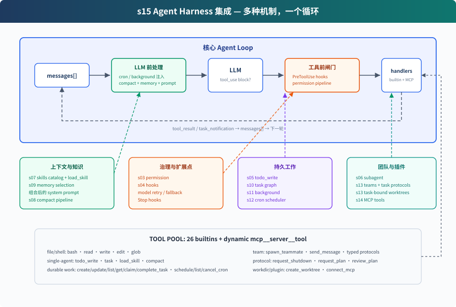

# hoppinzq-module-agent-24-harness（集成宿主 / Agent Harness）

对应 Python 教程 `s15_integrated_harness`。**多种机制，一个循环** —— 不引入新机制，而是把前面各章的组件接到同一个 agent loop 上，展示它们从哪里进入模型循环、产生的事件又如何回到同一段对话。



## 循环结构

```
用户输入
  → UserPromptSubmit hooks
  → cron 队列注入（定时 prompt 当作本轮输入）
  → background 通知注入（已完成的后台任务结果）
  → context compact
  → memory + skills + MCP 状态组装 system prompt
  → LLM
  → 有 tool_use block?
      否 → Stop hooks → 回到等待输入
      是 → PreToolUse hooks + permission
          → TOOL_HANDLERS / MCP handlers / background dispatch
          → PostToolUse hooks
          → tool_result 追加回 messages
          → 下一轮
```

循环本身没有变化：调用模型 → 检查响应里有没有 `tool_use` → 执行工具 → 把结果追加回 `messages`。是否继续工具轮，由响应中有没有实际的 `tool_use` 决定。

## 组件在循环中的位置

| 位置 | 组件 | 作用 |
|------|------|------|
| 用户输入后 | `UserPromptSubmit` hooks | 记录、注入、审计用户输入 |
| LLM 前 | cron 队列 | 把定时触发的 prompt 注入 `messages` |
| LLM 前 | background 通知 | 后台任务完成后以「后台任务结果」注入 |
| LLM 前 | compaction pipeline | 先压大输出，再裁历史，再压旧 tool_result，必要时摘要 |
| LLM 前 | system prompt 组装 | 身份 + 工具说明 + skills 目录 + MCP 状态 |
| 工具执行前 | `PreToolUse` hooks + permission | 拦截危险命令、写越界 |
| 工具分发 | 工具池 | 内置工具 + 动态注册的 MCP 工具 |
| 工具执行 | background dispatch | `bash_background` 放入线程池，主循环先返回占位结果 |
| 工具执行后 | `PostToolUse` hooks | 大输出告警、日志等后处理 |
| 返回循环 | tool_result | 每个 `tool_use` 对应一个 `tool_result`，再回到下一轮 |
| 本轮无 tool_use | `Stop` hooks | 统计、清理、审计 |

## 工具总览（29 个）

| 分组 | 数量 | 工具名 |
|---|---|---|
| 基础 | 6 | bash, read_file, write_file, edit_file, list_files, content_search |
| cron | 3 | schedule_cron, list_crons, cancel_cron |
| background | 2 | bash_background, check_background |
| teams | 3 | spawn_teammate, send_message, check_inbox |
| protocol | 3 | request_shutdown, request_plan, review_plan |
| task（任务图） | 5 | create_task, list_tasks, get_task, claim_task, complete_task |
| worktree | 3 | create_worktree, remove_worktree, keep_worktree |
| mock MCP | 5 | connect_mcp, mcp__docs__search, mcp__docs__get_version, mcp__deploy__status, mcp__deploy__run |

## 后台任务路径（相对 module-21 的增量）

```
bash_background(command)
  → BackgroundManager.runInBackground 放进线程池
  → 立即返回占位结果（task_id），主循环不等命令结束
  → 命令结束产生 BackgroundNotification
  → 下一次 LLM 调用前，ZQAgent.chatMessage 调 injectBackgroundNotifications
  → 结果作为「后台任务结果」user 消息追加进 messages
```

实现位置：

- `tool/background/BackgroundManager.java` —— 任务注册、状态查询、通知队列
- `tool/Tools.java` —— `runBashBackground` / `checkBackground` 处理器（静态注入位 `setBackgroundManager`）
- `base/ZQAgent.java` —— `chatMessage` 里的单一注入点（`backgroundManager` 字段）

## 两层计划

- `todo_write`：当前会话内的轻量计划，保存在内存中
- task graph：跨会话、可依赖、可认领的任务文件，写入 `.tasks/task_*.json`

两者目标相近但实现不同：`todo_write` 整表替换当前会话清单；task record 有稳定 ID 和单条生命周期更新。

## 两种 delegation

- `spawn_teammate`：启动 teammate 线程，独立 `messages[]`，通过共享 mailbox 与 lead 通信
- lead 每轮结束 poll 自己的 inbox，按协议消息类型路由

## 配置 & 运行

编辑 `src/main/java/com/hoppinzq/agent/constant/AIConstants.java`，填好 `API_KEY` / `BASE_URL` / `MODEL`。

```bash
# 编译
mvn -pl hoppinzq-module-agent-24-harness -am compile

# 运行
mvn -pl hoppinzq-module-agent-24-harness exec:java -Dexec.mainClass=com.hoppinzq.agent.AgentHarness
```

## 试一下

1. `建一份检查仓库的 todo，然后列出所有 Java 文件`
2. `connect docs MCP server 然后搜索 agent loop`（验 mock MCP：下一轮工具池里出现 `mcp__docs__search`）
3. `创建两个任务，分别 create_worktree 绑定，spawn alice 和 bob 自主干活`
4. `3 分钟后提醒我开会`（cron one-shot）
5. `后台运行 mvn compile，同时继续读 README`（验 background：占位返回 → 完成通知注入）

观察重点：

- 工具调用前后是否经过 hooks / permission
- `connect_mcp` 后下一轮是否出现 MCP 工具
- `bash_background` 是否立即返回 task_id 占位结果，而不是阻塞
- 到点是否自动提醒开会