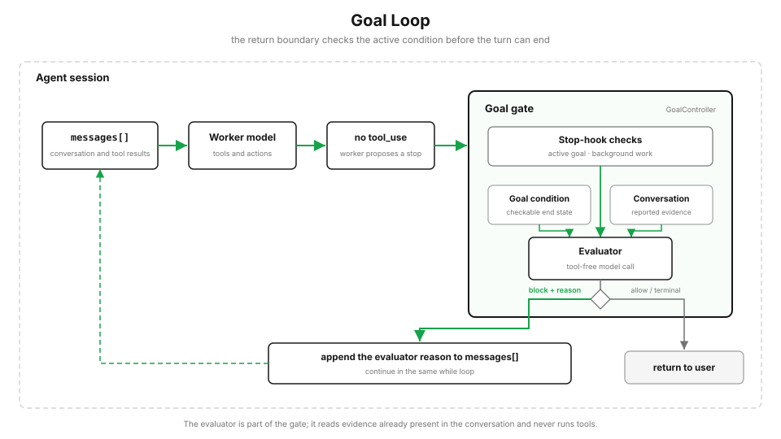

# hoppinzq-module-agent-25-goaloop（Goal Loop）

对应 Python 教程 `s17_goal_loop`。

> 模型不再调用工具，只代表这一轮想停；目标是否完成，再交给一个独立判断器。



从 s01 开始，Agent Loop 的退出条件一直很简单：模型不再调用工具，程序就返回。这对普通对话足够，但对「修到测试全部通过」「完成所有验收项」这样的任务还不够 —— 模型可能认为已经做完，也可能只完成了一部分。没有新的 `tool_use`，只能说明当前轮次结束了，不能直接证明整个目标已经达成。

`/goal` 在真正返回之前，再加一次独立判断。

## /goal 是一个会话级 Stop hook

```text
/goal pytest tests/auth 退出码为 0，并且 lint 没有错误
```

程序保存完成条件，并立即把这段条件作为本轮任务交给主模型 —— 用户不需要再输入一条「开始执行」。

当主模型不再调用工具时，主循环不会立刻返回，而是先运行 Goal Stop hook：

```java
if (hasPendingToolCalls(response)) {   // 还有工具调用 → 继续干活
    ...
    continue;
}

// === Goal Gate：模型不再调用工具 ≠ 目标已完成 ===
GoalDecision decision = goalController.evaluateAfterTurn(messageParams, false);
if (decision.isBlock()) {
    appendMessage(LlmMessage.user(goalController.continueMessage(decision)));
    continue;                           // 未完成：回到同一个 while 循环
}
break;                                  // 真正结束
```

没有活跃目标时，这个 hook 直接放行，退出条件仍然和 s01 一样。

## 判断器和干活的模型分开

主模型负责修改代码、运行命令和解决问题。Goal 判断器是另一次独立的模型调用，只负责判断完成条件。

判断器会看到：

- 当前 Goal 的完成条件；
- 到目前为止的对话记录；
- 主模型运行工具后写回来的结果。

判断器**没有工具**，不能自己读取文件，也不能重新运行测试。它只能根据对话中已经出现的内容做判断：

```json
{
  "ok": false,
  "reason": "对话中还没有出现 pytest 的退出码",
  "impossible": false
}
```

`ok=true` 表示条件已经满足；`ok=false` 表示还要继续；如果目标已经无法完成，则返回 `impossible=true`。

## 对话记录就是判断依据

送给判断器的内容会保留最近的完整消息；如果最新一条消息本身过长，就只保留它的开头（3/4）和结尾（1/4），避免一条工具结果占满整次判断请求（`PromptGoalEvaluator.transcriptText`，上限 `GOAL_TRANSCRIPT_MAX_CHARS`）。

这并不表示模型说一句「测试通过了」就一定会被接受。判断器的提示明确要求根据对话中的具体结果判断，**不能把没有结果支撑的宣称当成完成**。

但它终究只是一个只读对话的模型，可靠性取决于对话里有没有把关键结果说清楚。因此主模型的 system prompt 会要求：

> 运行验证命令后，把命令和结果明确写进对话，让独立判断器能够检查。

Goal Loop 不是测试框架。真正的验证仍然由工具执行，它只负责判断验证结果是否已经出现在当前工作记录中。

## 好的完成条件要能检查

「把代码弄好」太模糊。更合适的条件会写清三件事：

1. **结束状态**：最终要达到什么结果；
2. **验证方式**：用什么命令或输出证明；
3. **限制条件**：完成过程中不能破坏什么。

```text
/goal 完成登录模块迁移，直到 pytest tests/auth 退出码为 0，
并且没有修改 tests/auth 之外的测试文件
```

## 判断结果与出口

| 动作 | 含义 | 主循环行为 |
|---|---|---|
| `allow` | 无活跃目标 | 与基础循环一致，直接结束 |
| `block` | 条件未满足 | 把理由回灌 `messages[]`，在当前 while 里 `continue` |
| `achieved` | 条件已满足 | 正常结束 |
| `failed` | 判断器认定无法完成 | 结束，**不伪装成功** |
| `limit` | 连续阻止次数超上限（`GOAL_STOP_HOOK_BLOCK_CAP`） | 把控制权还给用户，目标保持活跃 |
| `defer` | 后台任务仍在运行 | 暂不判断，保留目标 |
| `error` | 判断器调用失败 | 停止自动续轮，保留目标，错误交给用户 |

自动继续必须有出口。Goal 本身没有默认的「最多 N 轮」—— 是否满足完成条件，由判断器每轮重新判断。但任何自动机制都不能无限占住一次请求，所以 Stop hook 外保留两道通用出口：

- 主循环的全局 `MAX_TURNS`（`-DMAX_TURNS=20`）；
- Stop hook 连续阻止结束的次数上限。

达到上限时，程序把控制权还给用户，但不会把目标伪装成完成，也不会自动清除目标。

## 查看、替换和清除

每个会话同时只有一个活跃 Goal。

```text
/goal                       查看当前条件、已判断次数、经过时间、token 使用量和最近一次判断原因
/goal 新的完成条件           直接替换旧 Goal，并立即按新条件开始工作
/goal clear                 清除当前 Goal
```

`stop`、`off`、`reset`、`none`、`cancel` 也可以作为清除别名。

`GoalController.restore()` 可以从宿主保存的 `goal_status` 事件中恢复仍然活跃的 Goal；已经完成、失败或主动清除的 Goal 不会重新启动。恢复后保留完成条件，但重新计算轮数、时间和 token 使用量。

## 代码里新增了什么

以 module-10（hooks）副本为基础，保留基础工具和四类 hook，再加入四个 Goal 相关部件：

| 部件 | 作用 |
|---|---|
| `tool/goal/GoalState` | 保存条件、判断次数、开始时间和最近原因 |
| `tool/goal/PromptGoalEvaluator` | 用一次独立模型调用读取对话并返回判断 |
| `tool/goal/GoalController` | 设置、查看、清除 Goal，并实现 Stop hook |
| `base/ZQAgent`（`runQuery` 退出边界） | 在原来的退出位置接入 Goal 判断 |

接入点只有几行：

```java
GoalDecision decision = goalController.evaluateAfterTurn(messageParams, false);
if (decision.isBlock()) { continue; }
break;
```

辅助类型：`GoalDecision`（裁决 + 动作常量）、`GoalEvaluation`（判断结果）、`GoalEvaluator`（判断器接口）、`GoalException`。

## 配置 & 运行

编辑 `src/main/java/com/hoppinzq/agent/constant/AIConstants.java`，填好 `API_KEY` / `BASE_URL` / `MODEL`。

可选：给 Goal 判断器使用更小的模型（环境变量 `GOAL_EVALUATOR_MODEL_ID`，未设置时用主模型）。

```bash
# 编译
mvn -pl hoppinzq-module-agent-25-goaloop -am compile

# 交互模式
mvn -pl hoppinzq-module-agent-25-goaloop exec:java -Dexec.mainClass=com.hoppinzq.agent.Agent25
```

进入交互模式后输入：

```text
/goal python -m pytest 退出码为 0
```

也可以直接从命令行设置 Goal，并限制自动执行轮数：

```bash
mvn -pl hoppinzq-module-agent-25-goaloop exec:java \
  -Dexec.mainClass=com.hoppinzq.agent.Agent25 \
  -DMAX_TURNS=20
# 然后在提示符下输入 /goal <完成条件>
```

## 观察重点

1. 设置了 `/goal` 后，模型停下来时程序**没有**直接返回，而是继续下一轮
2. 判断器返回的 `reason` 会出现在对话里（`[goal] block: ...`）
3. 条件满足后打印 `[goal] achieved: ...` 并结束
4. `MAX_TURNS` 用尽时打印 `max_turns`，目标仍保持活跃（用 `/goal` 仍能查到）
5. 判断器报错时**不会**宣称成功，而是停止自动续轮并交还用户